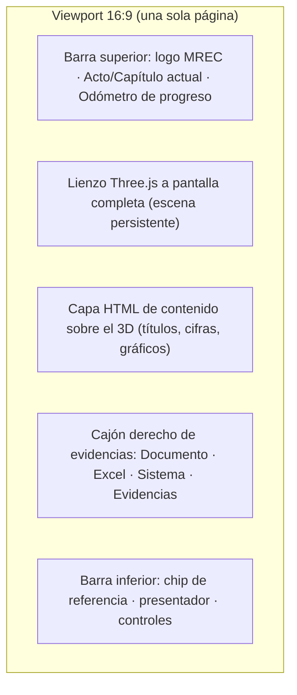

# Propuesta creativa: presentación interactiva 3D de MREC
### "EL ENSAMBLAJE": una moto se construye pieza a pieza mientras se arma el sistema

> Documento base para construir la presentación con Antigravity. **Aquí no hay código**: se define el concepto, la tecnología, la interfaz y el guion de cada slide (contenido, referencia exacta al documento, escena 3D, animaciones y transición).
> Fuente única: [Documento_Final_Unificado_MotoRepuestosElCentenario.md](file:///home/n/Escritorio/Proyectos/proyecto-ing-software/v3/MotoRepuestosElCentenario_Angel_Noel_Mendell/IV%20Entrega%20(FINAL)/Documento_Final_Unificado_MotoRepuestosElCentenario.md) y su PDF (352 páginas). Las páginas citadas se comprobaron sobre el PDF con `pdftotext`.

---

## 1. Concepto rector

**Metáfora:** Moto Repuestos El Centenario vende piezas de moto. La presentación **arma una motocicleta 3D pieza por pieza** y cada pieza corresponde a un capítulo del documento. Al principio la moto aparece como **plano azul (blueprint)** en wireframe. Cuando el equipo expone un capítulo, su pieza **se materializa** y pasa de líneas azules a metal cromado, con chispas de soldadura. En las **pruebas** la moto sube al dinamómetro y **enciende el motor**. Al cierre sale **completa a la carretera**, que representa la operación evolutiva.

| Pieza de la moto | Capítulo / idea que representa | Por qué funciona |
| :--- | :--- | :--- |
| Chasis | Cap. 01 SABD: 8 tablas | La estructura que sostiene todo son los datos |
| Plano (wireframe) | Cap. 03 Requisitos / Cap. 06 UML | Antes de construir se dibuja |
| Motor multicilindro | Cap. 04 Monolito modular | **Un solo motor (un despliegue) con varios cilindros (módulos)** |
| Vista explosionada | Cap. 07 Diseño (8 modelos) | Cada pieza separada y etiquetada con su ID `M-…` |
| Transmisión (5 engranes) | Cap. 08 SOLID | 5 principios que engranan |
| Manubrio + tablero de mano | Cap. 09 UX | Es lo que el usuario toca |
| Frenos + llave inmovilizadora | Cap. 10 Seguridad | Detener lo indebido y controlar quién arranca |
| Dinamómetro + encendido | Cap. 11–12 Pruebas | El banco de pruebas demuestra que funciona |
| El taller / local 3D | Cap. 13–14 Escenario e infraestructura | Dónde vive la moto |
| Tanque de combustible | Cap. 15 Finanzas | Lo que mantiene el proyecto en marcha (flujo de caja) |
| Título de propiedad + llaves | Cap. 16 Contrato | Entrega legal |
| Tablero de instrumentos | Cap. 17 Excel (9 hojas) | Los indicadores en vivo |
| Arnés eléctrico | Cap. 18 Trazabilidad | Conecta cada requisito con su prueba |
| La carretera | Cap. 20 Operación evolutiva | El camino que sigue después de la entrega |

**Estructura narrativa:** 4 **actos**, uno por entrega, igual que el índice del documento ([Índice General, pág. 2](file:///home/n/Escritorio/Proyectos/proyecto-ing-software/v3/MotoRepuestosElCentenario_Angel_Noel_Mendell/IV%20Entrega%20(FINAL)/Documento_Final_Unificado_MotoRepuestosElCentenario.md#L22-L50)).

---

## 2. Interfaz persistente: nunca se sale de la página

Requisito del profesor: **el documento y el Excel siempre están a la vista o a una tecla de distancia, sin abrir otra pestaña.**

### 2.1 Elementos fijos

| Zona | Contenido | Comportamiento |
| :--- | :--- | :--- |
| **Barra superior** | Logo, nombre del acto, capítulo y **mini-moto de progreso**: la silueta de la moto se rellena con las piezas ya presentadas | La mini-moto sustituye a la barra de progreso tradicional. Al hacer clic en una pieza se salta a su slide |
| **Odómetro** | `km 012 / 036` en tipografía de tablero digital | Los dígitos ruedan como un odómetro mecánico al cambiar de slide |
| **Chip de referencia** (abajo a la izquierda) | `📄 Cap. 04 › Matriz de evaluación comparativa · pág. 117` | Late una vez al entrar al slide. Al hacer clic, abre el documento **en esa página y con la frase resaltada** |
| **Chip de Excel** (solo en slides financieros) | `📊 Flujos · B4:H12` | Abre el visor Excel en esa hoja y resalta el rango |
| **Cajón de evidencias** (derecha, 45 % del ancho) | Pestañas: **Documento** (PDF completo) · **Excel** (9 hojas) · **Sistema** (MREC en vivo) · **Evidencias** (registros de regresión y respaldo) | Se desliza desde la derecha. El 3D se desplaza a la izquierda y se desenfoca ligeramente, así la escena no desaparece |
| **Presentador** (abajo a la derecha) | Avatar + nombre de quien expone + cronómetro | Cambia con un fundido cuando cambia el expositor |

### 2.2 Atajos de teclado

| Tecla | Acción |
| :--- | :--- |
| `→` / `Espacio` · `←` | Siguiente / anterior |
| `D` | Abrir o cerrar **Documento** en la referencia del slide |
| `E` | Abrir o cerrar **Excel** en la hoja del slide |
| `S` | Abrir **Sistema** (demo en vivo) |
| `O` | **Vista general**: la carretera 3D con los 20 capítulos como mojones; clic para saltar |
| `F` | Pantalla completa |
| `P` | Modo presentador (notas + cronómetro en una segunda ventana) |

---

## 3. Con qué se construye (stack)

| Necesidad | Herramienta | Uso concreto |
| :--- | :--- | :--- |
| Empaquetado | **Vite** + JavaScript con módulos ES | Funciona sin conexión, empaqueta el worker de PDF.js y se publica en Netlify como las entregas anteriores |
| 3D | **Three.js** (r160+) | `GLTFLoader` + `DRACOLoader` para la moto, `RoomEnvironment`/PMREM para reflejos cromados, `EffectComposer` con `UnrealBloomPass` (brillo de faros y bordes), `CSS2DRenderer` para etiquetas 3D y `ShaderMaterial` propio para el efecto de materialización |
| Animación | **GSAP 3** (incluye plugins) | Una línea de tiempo por slide, `SplitText` para títulos, `DrawSVG` para diagramas y firmas, `ScrambleText` para IDs técnicos |
| Documento incrustado | **PDF.js** (`pdfjs-dist`, visor oficial dentro de un iframe) | Enlace directo por hash: `viewer.html?file=doc.pdf#page=117&zoom=page-width&search=Matriz%20de%20evaluación&phrase=true`. Abre la página y resalta la frase |
| Excel incrustado | **Reutilizar `visor-excel.html`** (III Entrega, ya contiene las 9 hojas en `workbookData`) | Se añade una API `postMessage({sheet, range})` para abrir hoja y rango. Incluye un botón para descargar el `.xlsx` original. *Alternativa:* SheetJS para leer el `.xlsx` real |
| Gráficos | **Apache ECharts** | Velocímetros (VAN/TIR), cascada (proforma DGA), Sankey (trazabilidad), barras animadas (matrices ponderadas) |
| Código | **Shiki** | SQL del trigger y Python de servicios, con resaltado línea a línea sincronizado con la narración |
| Fórmulas | **KaTeX** | COCOMO, M/M/c y VAN |
| Sonido (opcional, silenciado por defecto) | **Howler.js** | Arranque del motor, clic de llave, sello. Se activa con `M` |

**Activos que se reutilizan:**
- [visor-excel.html](file:///home/n/Escritorio/Proyectos/proyecto-ing-software/v3/MotoRepuestosElCentenario_Angel_Noel_Mendell/III%20Entrega%20(13-16)/Presentaci%C3%B3n/Presentacion/visor-excel.html): visor de las 9 hojas.
- [03_Modelo_Financiero_mrec.xlsx](file:///home/n/Escritorio/Proyectos/proyecto-ing-software/v3/MotoRepuestosElCentenario_Angel_Noel_Mendell/III%20Entrega%20(13-16)/03_Modelo_Financiero_mrec.xlsx): hojas `Resumen`, `Supuestos`, `COCOMO`, `Infraestructura`, `Riesgos`, `Inversion`, `Beneficios`, `Flujos`, `Capacidades`.
- Escenas 3D de la II Entrega ([scenes/](file:///home/n/Escritorio/Proyectos/proyecto-ing-software/v3/MotoRepuestosElCentenario_Angel_Noel_Mendell/II%20Entrega%20(7-12)/Presentaci%C3%B3n%20entorno%20HTML-3D/Presentacion/scenes)): `db.js`, `security.js`, `testing.js`, `solid.js`, `ux.js`, `tech.js`, como punto de partida.
- Evidencias reales para la pestaña **Evidencias**: [MREC/docs/evidencias/](file:///home/n/Escritorio/Proyectos/proyecto-ing-software/v3/MREC/docs/evidencias). Incluyen la progresión de regresiones `104 → 111 → 113 → 120`, la de 500 ventas concurrentes, el catálogo de 20 000 productos y la restauración.
- El propio sistema MREC (`iniciar_servidor.sh`) se carga en un iframe en la pestaña **Sistema**. Si no se puede ejecutar en vivo, se muestra un video MP4 grabado.

---

## 4. Identidad visual

### 4.1 Paleta: taller industrial nocturno

| Rol | Color | Uso |
| :--- | :--- | :--- |
| Fondo asfalto | `#0B0E13` → `#151A22` (degradado radial) | Fondo general con grano sutil |
| Plano / blueprint | `#3BA0FF` líneas, `#0D2A4A` relleno | Piezas aún no presentadas, retícula técnica |
| Acento Centenario | `#FF6B1A` (naranja de taller) | Bordes de materialización, cifras clave, chispas |
| Acero continuidad | `#5B9BD5` | El mismo azul de la presentación de la II Entrega, por coherencia |
| Cromo | Material físico con metalness 1 y roughness 0.15 | Piezas materializadas |
| Éxito | `#2EE59D` | "Aprobado", "100 % OK", VAN positivo |
| Alerta | `#FF3B4E` | Stock crítico, amenazas, "DESCARTADO" |

### 4.2 Tipografía
- **Títulos:** *Space Grotesk* 700, mayúsculas, con interletrado amplio.
- **Texto:** *Inter* 400/500.
- **IDs, cifras y código:** *JetBrains Mono* (`RF-06`, `P95 = 0.029 s`, `$15,176.26`).
- **Odómetro y velocímetros:** *DSEG7* (fuente de 7 segmentos).

### 4.3 Atmósfera 3D
- Piso de taller reflectante oscuro (reflector con desenfoque) y una **retícula de plano** que se desvanece con la distancia.
- Iluminación: un *key light* cálido, un *rim light* azul y bloom solo en elementos emisivos (faros, bordes naranja, LEDs del rack).
- Partículas de polvo flotando dentro del haz de luz principal (opacidad 5 %).
- Profundidad de campo breve durante las transiciones de cámara.

---

## 5. Gramática de animación (reglas comunes a toda la página)

Con estas reglas Antigravity implementa todos los slides de forma consistente:

| Evento | Animación | Duración / curva |
| :--- | :--- | :--- |
| **Entrada de título** | `SplitText` por palabra: sube 40 px y aparece con fundido; subrayado naranja que se dibuja de izquierda a derecha | 0.7 s · `power3.out` · escalonado 0.06 s |
| **Listas / tarjetas** | Aparición escalonada de abajo hacia arriba, con un leve giro en el eje X (de 8° a 0°) | 0.5 s c/u · escalonado 0.08 s |
| **Cifras** | Contador desde 0 con formato de moneda/porcentaje y un destello naranja al terminar | 1.2 s · `power2.out` |
| **IDs técnicos** | `ScrambleText` con caracteres hexadecimales antes de resolverse (`SYS-FN-014`) | 0.6 s |
| **Cambio de slide dentro de un acto** | Movimiento de cámara hacia el siguiente punto de la escena, mientras el HTML se funde con un desenfoque de 8 px | 1.4 s · `power2.inOut` |
| **Cambio de acto** | **Barrido de faro**: un haz de luz cruza la pantalla, fundido a negro y tarjeta de acto a pantalla completa (`ACTO II`, título, rango de capítulos). La tarjeta se mantiene 1.5 s y la nueva escena se revela desde el centro con una máscara circular | 2.8 s en total |
| **Materialización de pieza** | Shader de disolución con ruido: la pieza pasa de wireframe azul a cromo con un borde naranja emisivo que avanza sobre la superficie, chispas de soldadura y un pequeño rebote al encajar | 1.8 s |
| **Chip de referencia** | Late (escala 1 → 1.08 → 1) con un anillo naranja expansivo | 0.6 s, una vez |
| **Apertura del cajón** | Se desliza desde la derecha; el 3D se encoge al 55 % y se desenfoca 2 px | 0.5 s · `expo.out` |
| **Movimiento reducido** | Con `prefers-reduced-motion` las transiciones se convierten en fundidos simples y el 3D queda estático | — |

---

## 6. Sistema de referencias al documento

Cada slide lleva **una o varias referencias exactas**, siempre en este formato:

`📄 Cap. NN › Sección › Subsección · pág. PDF`

Datos de cada referencia (para el archivo `refs.json`):

| Campo | Ejemplo | Para qué sirve |
| :--- | :--- | :--- |
| `cap` | `04` | Etiqueta visible |
| `seccion` | `Alternativas de arquitectura evaluadas › Matriz de evaluación comparativa` | Ruta visible en el chip |
| `pdfPage` | `117` | Salto directo con PDF.js |
| `search` | `Matriz de evaluación comparativa` | Resaltado con `#search=…&phrase=true` |
| `mdLine` | `2125` | Trazabilidad con el `.md` fuente |
| `excel` *(opcional)* | `{ "sheet": "Flujos", "range": "A1:H20" }` | Abre el visor Excel |

> [!TIP]
> El anexo final de este documento contiene la tabla completa de páginas PDF y líneas del `.md`, ya verificada. Si el PDF se vuelve a generar, basta con repetir la búsqueda de cada encabezado con `pdftotext` para actualizar `refs.json`.

---

## 7. Guion slide por slide

**Plantilla de cada slide:** 🎤 Presentador · 🧾 Contenido · 📄 Referencia · 🧊 Escena 3D · ✨ Animación · 🖱️ Interacción · ➡️ Transición

Presentadores sugeridos según el rol que declara el documento ([Dictamen Final, pág. 349](file:///home/n/Escritorio/Proyectos/proyecto-ing-software/v3/MotoRepuestosElCentenario_Angel_Noel_Mendell/IV%20Entrega%20(FINAL)/Documento_Final_Unificado_MotoRepuestosElCentenario.md#L7527-L7529)):
- **Ángel**: Arquitectura / Backend
- **Noel**: BD / Pruebas
- **Mendell**: UX / Metodología

---

### PRÓLOGO

#### S00 · Llave de contacto (pantalla de arranque)
- 🎤 Ángel
- 🧾 *"Sistema de Gestión de Inventario y Facturación — Moto Repuestos El Centenario, S.A."*, UNI · DACTIC · Ingeniería de Software 1 · Ing. Roberto Alfaro · Grupo 4S1-COM-S · los 3 integrantes con su carnet.
- 📄 Portada · pág. 1
- 🧊 Oscuridad total. Al centro flota una **llave de moto 3D** cromada que gira lentamente, con un llavero grabado "MREC". Al fondo se intuye la silueta de la moto en wireframe azul muy tenue.
- ✨ Al pulsar `Enter`, la llave gira 90° (clic metálico), el tablero se enciende con un barrido de agujas, **los faros iluminan** el título y este se revela en el haz de luz. Los nombres aparecen como placas grabadas.
- 🖱️ Si se mueve el ratón, la luz de los faros sigue ligeramente al cursor (parallax).
- ➡️ La cámara se eleva y muestra la **carretera** con 4 tramos.

#### S01 · La ruta (índice)
- 🎤 Ángel
- 🧾 Las 4 entregas y sus 20 capítulos. Mensaje: *"Hoy recorremos la ruta completa: del plano a la carretera"*.
- 📄 Índice General del Documento Unificado · pág. 2
- 🧊 Una carretera serpenteante vista desde arriba con **4 tramos de color**: I azul plano, II acero, III naranja y IV verde. En el borde, **20 mojones**; cada uno muestra el número de capítulo.
- ✨ La carretera se dibuja desde el origen (DrawSVG proyectado sobre el plano). Los mojones aparecen uno a uno y rebotan al caer.
- 🖱️ Al pasar el ratón sobre un mojón aparece el título del capítulo y su página PDF; con clic se salta allí. Esta misma escena es la **vista general** (`O`).
- ➡️ La cámara baja a ras de suelo en el mojón 01 → **tarjeta de ACTO I**.

---

### ACTO I · EL PLANO (Entrega I · Cap. 01–07)
*La moto está en wireframe azul sobre una mesa de dibujo infinita.*

#### S02 · El problema
- 🎤 Mendell
- 🧾 Los 4 puntos críticos: **inconsistencia de inventario**, **falta de trazabilidad en ventas**, **riesgo en la integridad de la información** e **ineficiencia en la atención**. Hoy el negocio funciona con bitácoras físicas.
- 📄 Cap. 01 › Planteamiento del problema · pág. 10 · Cap. 02 › Problema de estudio · pág. 39
- 🧊 Un **cuaderno de bitácora 3D** con páginas manuscritas se abre sobre la mesa. Las páginas se desprenden y vuelan con errores en rojo ("stock: ¿3? ¿5?", "factura #???").
- ✨ Cuatro tarjetas de dolor caen como hojas y se acomodan en una cuadrícula 2×2, cada una con su ícono: caja vacía, huella perdida, candado roto y reloj.
- ➡️ **Transición clave:** las hojas sueltas se descomponen en partículas que fluyen hacia un **cilindro de base de datos** luminoso. Se plantea así la solución.

#### S03 · Caso de estudio: el negocio
- 🎤 Mendell
- 🧾 Managua, fundado en 2020 por Alejandra Alemán; gamas **A / AA / AAA**; marcas Yamaha, TVS, Genesis, RK y CR. Flujo crítico: consulta → venta → factura → stock → auditoría.
- 📄 Cap. 01 › Caso de estudio · pág. 10 · Cap. 02 › Contexto del negocio · pág. 41
- 🧊 **Fachada low-poly isométrica** del local, con un rótulo de neón "El Centenario" que parpadea al encenderse. Sobre el local flotan las insignias de las 5 marcas y 3 cajas apiladas con las gamas A, AA y AAA.
- ✨ El flujo crítico es una **cadena de 5 nodos** recorrida por un pulso de luz naranja; cada nodo se ilumina cuando el pulso pasa.
- ➡️ La cámara atraviesa la puerta del local hacia un espacio de plano limpio.

#### S04 · Objetivos y alcance
- 🎤 Mendell
- 🧾 Objetivo general. Metas medibles: **OBJ-01** cero ventas con saldo negativo · **OBJ-02** P95 de búsqueda ≤ 3 s y venta en ≤ 4 pantallas · **OBJ-03** trazabilidad del 100 % · **OBJ-04** respaldo y recuperación · **OBJ-05** reportes de decisión. Alcance funcional y exclusiones.
- 📄 Cap. 02 › Objetivo general y objetivos específicos · pág. 39 y siguientes · Cap. 02 › Alcance funcional · pág. 44 · Cap. 03 › StRS › Objetivos y metas · pág. 63
- 🧊 Cinco **diales de tablero** en arco. Cada aguja apunta a su meta.
- ✨ Las agujas barren de 0 hasta la meta con un leve rebote. Las exclusiones (contabilidad compleja, pagos en línea) aparecen tachadas con una línea roja dibujada.
- ➡️ Los diales se reducen y se convierten en puntos que orbitan → S05.

#### S05 · Partes interesadas
- 🎤 Mendell
- 🧾 Propietaria, gerencia, administración, vendedor, bodega y equipo de desarrollo, con sus responsabilidades.
- 📄 Cap. 02 › Partes interesadas y responsabilidades · pág. 46 · Cap. 03 › StRS › Partes interesadas · pág. 54
- 🧊 **Avatares low-poly** orbitando un núcleo luminoso (el sistema); la distancia al núcleo indica el nivel de interacción.
- 🖱️ Al hacer clic en un avatar se detiene la órbita y aparece una ficha con su rol y su preocupación principal.
- ➡️ El núcleo se convierte en el primer bloque del chasis.

#### S06 · SABD: el chasis de datos
- 🎤 Ángel
- 🧾 Las **8 tablas**: Categorías, Proveedores, Clientes, Empleados, Productos, Facturas, Detalle_Facturas y Compras_Proveedores. Relaciones PK/FK y diccionario de datos.
- 📄 Cap. 01 › Entidades y atributos · pág. 15 · Modelo relacional · pág. 16 · Diccionarios de datos · pág. 17
- 🧊 Las 8 tablas son **bloques de vidrio luminoso** con sus columnas grabadas. Las FK son **tubos metálicos soldados** entre bloques. Al terminar, los bloques se reorganizan y **forman el chasis de la moto**.
- ✨ **Primera materialización:** el CHASIS pasa de wireframe a cromo (efecto de disolución) y la mini-moto superior se rellena con su primera pieza.
- 🖱️ Al pasar el ratón sobre una tabla se despliega su diccionario como una ficha técnica flotante.
- ➡️ Zoom hacia la tabla `Productos`.

#### S07 · SABD: lógica que vive en el servidor
- 🎤 Ángel
- 🧾 **Trigger 1**: deducción automática y validación rígida del stock. **3 vistas**: alerta de inventario crítico, historial analítico y mapeo de transacciones. **2 procedimientos**: registrar compra y abrir factura. **Seguridad DCL** con roles Administrador y Operador. **15 consultas** analíticas.
- 📄 Cap. 01 › Pruebas y evidencias › Trigger 1 · pág. 33 · Vistas · pág. 32 · Procedimientos · pág. 33 · Apartado de seguridad y control de accesos · pág. 34 · Catálogo de consultas · pág. 26
- 🧊 **Simulación en vivo**: una caja 3D "Pistón 150cc · stock 3". Llega una venta de 1 unidad → **rayo eléctrico** (trigger) → stock 2. Llega una venta de 5 unidades → un **escudo rojo** rechaza la operación con `RAISE EXCEPTION`.
- ✨ A la derecha, un panel con el SQL del trigger resaltado con Shiki: la línea activa se ilumina en sincronía con la animación.
- 🖱️ Botones "Vender 1" y "Vender 5" para repetir la simulación frente al profesor.
- ➡️ El rayo asciende y se convierte en las líneas de una pirámide (requisitos).

#### S08 · Requisitos: de la necesidad al software
- 🎤 Noel
- 🧾 Jerarquía ISO/IEC/IEEE 29148: **StRS → SyRS → SRS**. Cantidades: **15 RN · 16 ST-REQ · 30 SYS-FN · 72 SRS**.
- 📄 Cap. 03 › Requisitos de usuario · pág. 67 · Requisitos funcionales del sistema · pág. 72 · SRS › Funciones · pág. 84
- 🧊 **Pirámide invertida (embudo) de 3 niveles de vidrio**. Las partículas entran por arriba como necesidades y bajan refinándose: el color cambia de naranja a azul y las partículas se vuelven más pequeñas y ordenadas.
- ✨ Cada nivel muestra su contador animado. Los IDs aparecen con `ScrambleText`.
- 🖱️ Al hacer clic en un nivel se despliega la tabla de ejemplos con 3 requisitos reales de ese nivel.
- ➡️ Las partículas del fondo del embudo forman un velocímetro.

#### S09 · Calidad que se puede medir (RNF y reglas de negocio)
- 🎤 Noel
- 🧾 Rendimiento (P95 de búsqueda ≤ 3 s, P95 de venta ≤ 5 s), seguridad del sistema y reglas operacionales clave (RN-01 stock no negativo, etc.).
- 📄 Cap. 03 › Requisitos de rendimiento · pág. 75 · Seguridad del sistema · pág. 79 · Políticas y reglas operacionales · pág. 64
- 🧊 Un **velocímetro** con zona verde hasta 3 s y otro hasta 5 s. Las reglas de negocio aparecen como **señales de tránsito** reglamentarias.
- ✨ Las agujas tiemblan y se estabilizan dentro de la zona verde. *Prefigura los resultados de pruebas; se retoma en S20.*
- ➡️ Barrido lateral hacia el banco de motores.

#### S10 · Arquitectura: tres motores en competencia
- 🎤 Ángel
- 🧾 **A**: monolito tradicional en 3 capas · **B**: monolito modular en capas · **C**: microservicios. Matriz ponderada de 8 criterios → **A 72 · B 96 · C 74**.
- 📄 Cap. 04 › Alternativas de arquitectura evaluadas › Matriz de evaluación comparativa · pág. 117
- 🧊 Tres **motores 3D** sobre pedestales:
  - **A:** un motor monocilíndrico viejo y opaco.
  - **B:** un motor multicilindro limpio, con cilindros etiquetados.
  - **C:** **docenas de motorcitos** unidos por cables enredados (la complejidad de red).
- ✨ **Carrera de barras apiladas**: criterio por criterio (C-01 … C-08), cada barra crece con un segmento del color del criterio. Al final B queda en 96 y se ilumina; A y C se oscurecen.
- 🖱️ Al pasar el ratón sobre un segmento aparece el peso y la calificación del criterio.
- ➡️ La cámara rodea el motor B.

#### S11 · Decisión: monolito modular en capas
- 🎤 Ángel
- 🧾 Decisión adoptada y sus razones; principios **PA-01 a PA-08**; vistas **V-01 a V-05**; capas Presentación → Aplicación → Dominio → Persistencia; módulos Catálogo, Compras, Inventario, Ventas y Seguridad.
- 📄 Cap. 04 › Decisión adoptada · pág. 119 · Principios arquitectónicos fundamentales · pág. 119 · Vistas de arquitectura definidas · pág. 122
- 🧊 El motor B se abre en **capas horizontales apiladas** (vista explosionada vertical). Cada cilindro es un módulo de negocio. Las flechas de dependencia apuntan solo hacia el dominio y se marcan con pulsos de luz.
- ✨ Los 8 principios aparecen como **placas grabadas** atornilladas al bloque del motor. Después las capas se cierran y el **MOTOR se materializa** en la moto.
- ➡️ La cámara retrocede: aparece una línea de ensamblaje.

#### S12 · Metodología: incremental (88/100)
- 🎤 Mendell
- 🧾 Cinco modelos comparados: **Incremental 88** · Proceso Unificado 79 · Espiral 78 · Cascada 54 · V 54. **Renuncia expresa a Scrum** con sus razones.
- 📄 Cap. 05 › Alternativas de ciclo de vida › Matriz ponderada · pág. 140 · Renuncia expresa a Scrum · pág. 148
- 🧊 Gráfico de barras animado tipo podio. Al costado, una tarjeta "SCRUM" recibe un **sello rojo "DESCARTADO"** que cae girando.
- ✨ El sello levanta polvo al impactar. Debajo se escriben en tipeo las razones: no hay Product Owner con autoridad, no hay cadencia de Sprint y la línea base es documental.
- ➡️ El podio se transforma en 4 losas de ensamblaje.

#### S13 · Plan de incrementos, WBS, ruta crítica y RACI
- 🎤 Mendell
- 🧾 **I1** Acceso y catálogo · **I2** Compra y stock · **I3** Venta y caja · **I4** Posventa y operación. Son 12 semanas / 60 días hábiles y 9.01 PM. Incluye WBS de 4 niveles, CPM con holguras, Gantt semanal y matriz RACI.
- 📄 Cap. 05 › Plan de incrementos y horizonte temporal · pág. 150 · Estructura de Descomposición del Trabajo · pág. 151 · Ruta Crítica (CPM) · pág. 153 · Cronograma Maestro Semanal · pág. 154 · Matriz RACI · pág. 155
- 🧊 **Línea de ensamblaje 3D**: 4 estaciones. En cada una la moto gana piezas de forma acumulativa (I2 contiene a I1, etc.).
- ✨ Debajo, el **Gantt se dibuja** barra por barra. La **ruta crítica brilla en rojo pulsante** y las holguras aparecen en gris translúcido.
- 🖱️ Pestañas locales `WBS | CPM | Gantt | RACI` sin salir del slide.
- ➡️ La línea de ensamblaje se aplana y queda como un plano técnico.

#### S14 · Lenguaje de modelado: UML 2.5.1 selectivo
- 🎤 Mendell
- 🧾 Opciones: UML estándar, perfil UML específico y DSML autónomo. Se elige **UML 2.5.1 con un subconjunto controlado**; construir un DSML para un solo proyecto no se justifica.
- 📄 Cap. 06 › Alternativas correctamente delimitadas · pág. 172 · Criterios, puntuación y decisión · pág. 173
- 🧊 Una **balanza de taller**: en un platillo, "costo de construir un lenguaje"; en el otro, "utilidad para 1 proyecto". La balanza se inclina hacia UML.
- ✨ Los íconos de diagramas UML (caso de uso, clase, secuencia, estados, despliegue) se encienden uno a uno como herramientas que se cuelgan en un panel.
- ➡️ Las herramientas vuelan hacia la moto y anticipan la vista explosionada.

#### S15 · Documentación de diseño: la vista explosionada
- 🎤 Mendell
- 🧾 Ocho modelos: **M-UC-01, M-CMP-01, M-CLS-01, M-SEQ-01, M-SEQ-02, M-STM-01, M-STM-02, M-DEP-01**. Invariantes del dominio.
- 📄 Cap. 07 › Catálogo de modelos · pág. 185 · Invariantes del dominio · pág. 189 · M-STM-01 · pág. 190 · M-SEQ-01 · pág. 191 · M-DEP-01 · pág. 193
- 🧊 **Momento visual del acto**: la moto completa en wireframe hace una **explosión técnica** y todas las piezas se separan en el aire. Cada pieza lleva una etiqueta CSS2D con su modelo `M-…`.
- ✨ Al seleccionar M-SEQ-01 se dibuja el **diagrama de secuencia de venta**: líneas de vida verticales y mensajes que viajan como flechas animadas, incluido el camino de reversión en rojo.
- 🖱️ Al hacer clic en cada etiqueta se abre su modelo en el cajón del documento, en su página.
- ➡️ **Cierre del Acto I:** las piezas regresan y encajan con un clic sincronizado; un **sello "PLANO APROBADO"** cae sobre la escena → barrido de faro → **ACTO II**.

---

### ACTO II · CONSTRUCCIÓN Y BANCO DE PRUEBAS (Entrega II · Cap. 08–13)
*La escena pasa de la mesa de dibujo a un taller real: banco de trabajo, herramientas y luz cálida.*

#### S16 · SOLID: la transmisión
- 🎤 Ángel
- 🧾 S, O, L, I, D aplicados a módulos reales: `models.py`, `pricing.py`, `pricing_services.py`, `warranty_services.py`, `cancellation_services.py`, `catalog_queries.py`, `views.py`.
- 📄 Cap. 08 › Mapa de responsabilidades · pág. 204 · Análisis por principio · pág. 205 · Ejemplos trazables y pruebas · pág. 207
- 🧊 **Cinco engranes metálicos** con una letra grabada cada uno. Engranan y giran juntos.
- ✨ Al presentar cada principio, su engrane se adelanta, brilla en naranja y muestra el módulo de código asociado. Al terminar, los engranes se integran en la **TRANSMISIÓN**, que se materializa.
- 🖱️ Clic en un engrane → fragmento de código (Shiki) del ejemplo trazable.
- ➡️ Los engranes transmiten giro hacia el manubrio.

#### S17 · UX: lo que el vendedor toca
- 🎤 Mendell
- 🧾 Perfiles (vendedor, bodega, administración, gerencia) y sus tareas críticas. **Venta en ≤ 4 pantallas**, operación con teclado y lector como teclado, prevención y recuperación de errores.
- 📄 Cap. 09 › Contexto de uso y tareas · pág. 215 · Diseño aplicado · pág. 216 · Recorridos de demostración reproducibles · pág. 218
- 🧊 **Cuatro pantallas reales del POS de MREC** (capturas de `templates/commerce/sale.html`, etc.) como tarjetas de vidrio flotando en abanico. Debajo, un **teclado 3D** donde se presionan las teclas del recorrido.
- ✨ Las tarjetas giran en secuencia 1 → 2 → 3 → 4 mientras se ilumina la tecla usada. Un contador "Pantalla 1/4" avanza. El **MANUBRIO** se materializa.
- 🖱️ Botón "Ver en vivo" → pestaña **Sistema** con el POS real.
- ➡️ La cámara baja hacia la rueda delantera (frenos).

#### S18 · Programación segura: frenos y llave
- 🎤 Ángel
- 🧾 Amenazas → controles: acceso sin permiso (403), fuerza bruta (bloqueo tras 5 fallos), CSRF, **manipulación de precio** (el servidor recalcula), autoaprobación, carrera de inventario, pérdida histórica, exposición de datos, pérdida de respaldo. Sesiones de 30 min y auditoría con `correlation_id`.
- 📄 Cap. 10 › Análisis de amenazas y controles · pág. 226 · Autenticación y sesiones · pág. 228 · Verificación y riesgos residuales · pág. 229
- 🧊 La moto en el centro rodeada de **capas de escudo hexagonal** concéntricas. Desde los bordes llegan **proyectiles rojos** con etiquetas (SQLi, CSRF, fuerza bruta, precio manipulado…).
- ✨ Cada proyectil choca con su capa: destello, onda hexagonal y aparición del control que lo detuvo. Al final se materializan los **FRENOS** y la **LLAVE INMOVILIZADORA**.
- 🖱️ Al pasar el ratón sobre un impacto aparece una ficha con amenaza, control, evidencia y límite residual. Se muestra con honestidad: el documento declara límites, y eso suma puntos.
- ➡️ La moto avanza sobre rieles hacia el dinamómetro.

#### S19 · Pruebas de software: al dinamómetro
- 🎤 Noel
- 🧾 Marco ISO/IEC/IEEE 29119. Niveles: regla pura → servicio → BD/transacción → integración HTTP → regresión. Casos críticos **P-SW-01 a P-SW-11**. Resultado: **Ran 120 tests … OK en 289,28 s**, 0 fallos y 0 errores.
- 📄 Cap. 11 › Estrategia por nivel y riesgo · pág. 237 · Matriz de casos críticos · pág. 238 · Ejecución y resultados · pág. 240
- 🧊 La moto sube al **dinamómetro** (rodillos, sensores y cables). A la izquierda, una **pirámide de niveles de prueba**. A la derecha, una **terminal** de estilo retro.
- ✨ La terminal reproduce la salida real de la regresión: puntos que avanzan y `OK` en verde. Un **gráfico de evolución** muestra la regresión creciendo **104 → 111 → 113 → 120** (evidencias del 05, 06 y 11 de octubre). Los casos P-SW se marcan con una palomita verde uno a uno.
- 🖱️ Pestaña **Evidencias** → `2026-10-11-regresion-completa.md`.
- ➡️ La tensión sube: las luces del taller bajan y solo queda iluminado el dinamómetro.

#### S20 · Pruebas de base de datos y encendido (clímax técnico)
- 🎤 Noel
- 🧾 Invariantes y mecanismos (`UNIQUE`, `CHECK`, `quantity__gte`, `PROTECT`, `NUMERIC`). **Concurrencia por la última unidad**: dos intentos, un solo éxito, saldo 0. Importación atómica de 10 000 filas. Respaldo `pg_dump` + SHA-256 y restauración en base temporal (46 migraciones). Rendimiento: **P95 de búsqueda 0.029 s**, **500 ventas con P95 1.142 s**.
- 📄 Cap. 12 › Modelo y mecanismos bajo prueba · pág. 249 · Pruebas transaccionales y concurrentes · pág. 251 · Respaldo, restauración y límites · pág. 252 · Resultados de la verificación local · pág. 253
- 🧊 **Carrera por la última unidad**: dos motos-hilo arrancan hacia una caja con "stock 1". Una la toma; la otra **rebota contra una barrera** (`quantity__gte`) y la pantalla muestra "saldo final 0 · 1 salida".
- ✨ Los velocímetros de S09 regresan y sus agujas se clavan en **0.029 s** y **1.142 s**, muy dentro de la zona verde.
- ✨ **ENCENDIDO:** el motor arranca (sonido opcional), los rodillos giran, el escape emite luz, los faros encienden con bloom y la carrocería vibra. Texto final: **"120 / 120 · 0 fallos · 0 errores"**.
- 🖱️ Botón "Repetir carrera" para que el profesor la vea otra vez.
- ➡️ La cámara se aleja a través del techo del taller y revela el local completo.

#### S21 · Escenario técnico: la moto ya vive en el local
- 🎤 Ángel
- 🧾 Arquitectura implementada por capas (templates/views → services → models → PostgreSQL 18.4). 8 equipos cliente: 4 POS, bodega, administración, gerencia y propietaria. **Topología en estrella con 6 VLAN** (10 servidores, 20 POS, 30 oficinas, 40 bodega, 50 impresión, 99 gestión). Flujos demostrables.
- 📄 Cap. 13 › Arquitectura implementada · pág. 261 · Plano funcional de las áreas · pág. 271 · Diagrama de red y direccionamiento · pág. 272 · Flujos demostrables · pág. 275
- 🧊 **Corte isométrico del local**: mostrador con 4 POS, bodega, oficinas y rack. Cada VLAN es una **zona de piso con su color**. Los cables de red son líneas luminosas que convergen en el switch.
- ✨ Paquetes HTTPS (pequeños cubos) viajan de las POS al SRV1. Un intento de acceso de una POS al puerto de PostgreSQL **rebota** en el router (denegación entre VLAN).
- 🖱️ Al pasar el ratón sobre un equipo aparece su VLAN, IP y tráfico permitido.
- ➡️ **Cierre del Acto II:** la cámara se acerca al rack → barrido de faro → **ACTO III**.

---

### ACTO III · EL TALLER Y EL NEGOCIO (Entrega III · Cap. 14–16)
*Paleta más cálida (naranja/ámbar): es la parte del dinero.*

#### S22 · Lo que ya existía: activos preexistentes
- 🎤 Ángel
- 🧾 Inventario y valoración del hardware antiguo, su destino operativo y la comparativa energética entre el parque antiguo y el nuevo.
- 📄 Cap. 14 › Activos preexistentes · pág. 287 · Comparativa energética · pág. 288 · Cap. 15 › Inventario y valoración del hardware antiguo · pág. 316
- 🧊 Equipos viejos en **tono sepia**, con polvo y etiquetas de inventario colgando. Los que se reutilizan recuperan el color; los demás se desvanecen.
- ✨ Barras de consumo en vatios, antes y después, que se encogen con un efecto de "desinflado".
- ➡️ Desde el rack se desliza hacia afuera el servidor nuevo.

#### S23 · Servidor, NAS, red y respaldo 3-2-1
- 🎤 Ángel
- 🧾 **SRV1 Dell PowerEdge T150** (32 GB RAM ECC, RAID 1), **NAS Synology DS224+**, UPS, switch PoE+, AP. Respaldo **3-2-1**: SRV1 RAID 1 → NAS con snapshots Btrfs inmutables → USB LUKS2 fuera del local. Capacidad a 5 años: **58 GB de 1000 GB = 5.8 %**.
- 📄 Cap. 14 › Núcleo de Procesamiento Central · pág. 289 · Capacidad a 5 años · pág. 291 · Almacenamiento en red (NAS) · pág. 293 · Topología de red · pág. 295 · Continuidad operativa · pág. 297 · Cap. 15 › Estrategia de Respaldo 3-2-1 · pág. 322
- 🧊 **Rack 3D** con LEDs parpadeantes. El servidor sale como un cajón y deja ver los 2 discos en espejo. Tres "copias" (cubos con hash) viajan: servidor → NAS → USB, que sale por la puerta del local.
- ✨ Un **anillo de capacidad** se llena apenas hasta el 5.8 %, con el contador "58 GB / 1000 GB".
- 🖱️ Chip Excel → hoja `Capacidades`.
- ➡️ El USB vuela hacia un mapa: comienza el viaje logístico.

#### S24 · Proforma y nacionalización (DGA)
- 🎤 Noel
- 🧾 19 componentes. **EXW $7,770.09 → flete $800 → seguro $116.55 → CIF $8,686.64 → DAI $150 → impuesto $1,325.50 → Total nacionalizado $10,162.14**. Carga marítima frente a aérea.
- 📄 Cap. 14 › Proforma Estructural Consolidada · pág. 300 · Vectores Logísticos · pág. 302 · Modelado Tributario Aduanero · pág. 302 · Dualidad Presupuestaria · pág. 304
- 🧊 **Mapa estilizado** con la ruta de origen a Nicaragua: un barco y un avión trazan arcos; gana la ruta elegida.
- ✨ **Gráfico de cascada** (ECharts): cada escalón cae en sincronía con la llegada del barco a cada etapa (puerto, aduana, local).
- 🖱️ Chip Excel → hoja `Infraestructura`.
- ➡️ El contenedor llega al local, se abre y muestra el mostrador con clientes.

#### S25 · ¿Por qué 4 cajas? Teoría de colas M/M/c
- 🎤 Noel
- 🧾 Ticket promedio **C$ 240.38**; 1 040 facturas al mes. Con **2 cajas**: ρ = 95 %, **Wq ≈ 22.8 min**, abandono del 6.5 % ($5,298.84/año perdidos). Con **4 POS**: ρ = 47.5 %, **Wq ≈ 20.6 s**, abandono eliminado.
- 📄 Cap. 15 › Modelo Matemático de Facturación y Ticket Promedio · pág. 310 · Teoría de Colas (M/M/c) y Pérdidas por Abandono · pág. 312
- 🧊 **Simulación de cola 3D**: un mostrador con 2 cajas y una fila de 9 muñecos low-poly. Algunos se impacientan (ícono de reloj) y **se van**, mientras de sus siluetas salen billetes volando.
- ✨ Interruptor "2 cajas ↔ 4 POS": aparecen 2 cajas más, la fila se disuelve casi por completo y el contador baja de **22.8 min a 20.6 s**. La fórmula M/M/c (KaTeX) se escribe al lado.
- 🖱️ El presentador acciona el interruptor en vivo.
- ➡️ Los billetes recuperados caen en un tanque de combustible.

#### S26 · COCOMO II: cuánto cuesta construir el software
- 🎤 Ángel
- 🧾 Post-Architecture sobre **8.757 KLOC**, ΣSF = 9.00, E = 1.00, EAF = 0.35 → **9.0 PM · 3.0 meses** → $2,700 de desarrollo + $800 de instalación = **$3,500** (Cláusula V del contrato).
- 📄 Cap. 15 › Estimación del Costo de Desarrollo (COCOMO II) · pág. 314 · Cálculo Monetario del Desarrollo · pág. 315 · Cap. 05 › Conciliación con COCOMO II y Contrato
- 🧊 Una **calculadora mecánica 3D** con rodillos numéricos.
- ✨ La fórmula se arma término a término. Cada valor entra girando en los rodillos y el resultado final se imprime como un ticket que sale de la máquina.
- 🖱️ Chip Excel → hoja `COCOMO`.
- ➡️ El ticket vuela al tanque de combustible.

#### S27 · Inversión, OPEX y flujo de caja
- 🎤 Noel
- 🧾 **I0 = $13,662.14** (HW $10,162.14 + SW $3,500). Patrimonio tecnológico de $13,987.14 (incluye $325 preexistentes). **OPEX $2,400/año**. Beneficio $10,400 → **flujo neto +$8,000/año**. Depreciación según la Ley 822.
- 📄 Cap. 15 › Presupuesto Total de Inversión · pág. 319 · Depreciación Fiscal · pág. 319 · Comparación Cuantitativa de Gastos · pág. 323 · Gastos Fijos Operativos · pág. 324 · Flujo de Capital · pág. 326
- 🧊 El **TANQUE DE COMBUSTIBLE** transparente de la moto se ve por dentro. Año 0: se vacía (−$13,662.14). Años 1 a 5: se llena con +$8,000 cada año.
- ✨ Debajo, barras por año con una **línea acumulada que cruza el cero** en **1.71 años**. Sobre ese punto aparece un marcador "Payback" que rebota. Al final el **TANQUE se materializa** lleno.
- 🖱️ Chip Excel → hoja `Flujos` y hoja `Inversion`.
- ➡️ La cámara sube al tablero de la moto: los velocímetros.

#### S28 · Indicadores y sensibilidad
- 🎤 Noel
- 🧾 **VAN $15,176.26 · TIR 50.84 % (TMAR 12 %) · B/C 2.11 · ROI 192.78 % · Payback 1.71 / 2.08 años**. Escenarios: pesimista VAN $4,361.86 / TIR 24.23 % · optimista VAN $24,548.74 / TIR 72.51 %.
- 📄 Cap. 15 › Cálculo Detallado de Métricas Financieras · pág. 326 · Análisis de Sensibilidad · pág. 327 · Cap. 17 › Resumen Ejecutivo de Métricas · pág. 344
- 🧊 **Cuatro velocímetros grandes** (ECharts gauge con estética de tablero real). La aguja de la TIR sobrepasa la marca roja de la TMAR del 12 %.
- ✨ **Interacción estrella:** un selector `Pesimista | Base | Optimista` y un **slider de TMAR** recalculan el VAN en vivo con la fórmula del documento:
  $$VAN = -I_0 + FC \cdot \frac{1-(1+i)^{-5}}{i}$$
  Con los valores base, $-13{,}662.14 + 8{,}000 \times 3.6048 = 15{,}176.26$. Coincide con el Excel.
- 🖱️ El botón "Comprobar en Excel" abre la hoja `Flujos` y resalta la celda del VAN. Así se demuestra que la cifra es la misma.
- ➡️ Las agujas regresan a cero; un documento con sello de lacre cae sobre la escena.

#### S29 · Marco jurídico y contrato de licencia
- 🎤 Mendell
- 🧾 Ley 312 y Ley 577 (derechos de autor), Código Civil y Código de Comercio, Ley 787 (datos personales), Ley 822 (tributaria). Contrato de **12 cláusulas**: licencia perpetua e intransferible, garantía de 90 días y SLA. Acta de entrega y recepción.
- 📄 Cap. 15 › Marco Jurídico en Nicaragua · pág. 328 · Cap. 16 › Dictamen Jurídico Preliminar · pág. 335 · Texto Íntegro del Contrato · pág. 337 · Anexo I: Acta de Entrega · pág. 341
- 🧊 Un **pergamino/contrato 3D** sobre un escritorio de madera, con **sello de lacre** naranja. Las leyes son insignias metálicas a su alrededor.
- ✨ Las páginas se hojean y en cada una se resalta la cláusula clave. Al final, **una mano entrega las llaves** de la moto sobre el contrato (el título de propiedad).
- ➡️ **Cierre del Acto III:** el sello se estampa con un golpe y la cámara tiembla → barrido de faro → **ACTO IV**.

---

### ACTO IV · ENTREGA DE LLAVES Y RUTA (Entrega IV · Cap. 17–20)
*Escena de estudio: la moto sobre una plataforma giratoria con luces de exhibición.*

#### S30 · Modelo financiero automatizado (Excel de 9 hojas)
- 🎤 Noel
- 🧾 Arquitectura del libro: **Resumen, Supuestos, COCOMO, Infraestructura, Riesgos, Inversion, Beneficios, Flujos y Capacidades**. Fórmulas activas sin valores fijos. Integración con el visor web.
- 📄 Cap. 17 › 17.1 Arquitectura del Libro Financiero · pág. 343 · 17.3 Integración con el Visor Web · pág. 344
- 🧊 **Nueve hojas de vidrio** se despliegan en abanico como cartas. Cada una muestra el ícono y la cifra principal de su hoja. Las flechas entre hojas muestran qué hoja alimenta a cuál.
- ✨ Al terminar, las hojas se condensan en el **TABLERO DE INSTRUMENTOS** de la moto, que se materializa.
- 🖱️ Clic en una hoja → abre el **cajón de Excel** directamente en esa hoja. Es el momento ideal para dejar el Excel abierto y recorrerlo.
- ➡️ Desde el tablero salen cables hacia toda la moto.

#### S31 · Trazabilidad integral: el arnés eléctrico
- 🎤 Noel
- 🧾 **15 RN → 16 ST-REQ → 30 SYS-FN → 72 SRS → 24 RF/RNF → módulos Django → 120 pruebas**. Las 18 filas de la matriz están **100 % OK**. Esquema: de 8 tablas a 38 modelos y 46 migraciones.
- 📄 Cap. 18 › Matriz de Trazabilidad Integral · pág. 345 · 18.1 Resumen de Conformidad · pág. 346 · Cap. 03 › Matriz de trazabilidad bidireccional · pág. 95
- 🧊 El **ARNÉS ELÉCTRICO** recorre la moto. Cada cable une un `RF-xx` (etiqueta en la pieza correspondiente) con su prueba.
- ✨ Al recorrer la matriz, cada cable **se ilumina en verde de punta a punta**, de RF-01 a RNF-12, con el sello "100 % OK". En paralelo, un **diagrama Sankey** (ECharts) muestra el flujo RN → ST → SYS → SRS → RF/RNF → pruebas.
- 🖱️ Clic en un cable → fila completa de la matriz (requisito, módulo, prueba y estado).
- ➡️ Todos los cables quedan encendidos y la moto queda **completa**.

#### S32 · Conclusiones integrales
- 🎤 Los tres, una dimensión cada uno
- 🧾 Las 5 conclusiones: técnica y arquitectónica · calidad, UX y verificación · seguridad · financiera · legal.
- 📄 Cap. 19 › 19.1–19.5 · pág. 347–348
- 🧊 La **moto completa y cromada** gira en la plataforma con luces de estudio. Cinco **píldoras luminosas** orbitan alrededor, una por dimensión.
- ✨ Al nombrar cada dimensión, su píldora se acerca a la cámara y muestra la cifra clave: 46 migraciones · 120/120 · RBAC + auditoría · VAN $15,176.26 · licencia perpetua.
- ➡️ La plataforma se detiene; cae el telón del dictamen.

#### S33 · Dictamen final y acta de culminación
- 🎤 Ángel
- 🧾 **Dictamen académico favorable**; tabla de dimensiones auditadas; firmas del equipo y recepción institucional.
- 📄 Dictamen Final de Ingeniería y Acta de Culminación · pág. 349
- 🧊 Un documento oficial UNI a pantalla completa sobre la escena desenfocada.
- ✨ Un **sello "DICTAMEN FAVORABLE"** cae con impacto. Las **firmas se dibujan** con trazo de tinta (DrawSVG); cada integrante aparece cuando se dibuja su firma.
- ➡️ La moto sale de la plataforma hacia una puerta abierta al exterior: atardecer.

#### S34 · Operación evolutiva: la carretera
- 🎤 Ángel (20.1, 20.3) y Mendell (20.2, 20.4)
- 🧾 **20.1** Incidentes: ITIL 4, Google SRE, ISO/IEC 27035 y protocolo en 4 fases. **20.2** Deuda técnica: Fowler, SQALE, WSJF y negociación en 4 pasos. **20.3** Interoperabilidad: arquitectura hexagonal, API REST `/api/v1/`, Outbox, IA/RFID. **20.4** Requisitos cambiantes: Sommerville, MoSCoW y 6 recomendaciones.
- 📄 Cap. 20 › 20.1 · pág. 350 · 20.2 · pág. 350 · 20.3 · pág. 351 · 20.4 · pág. 351
- 🧊 La moto **rueda por una carretera al atardecer** (cámara de seguimiento). En el borde aparecen **4 señales de carretera** grandes, una por subsección. A lo lejos, en el horizonte, siluetas de tecnologías futuras: facturación electrónica, IA y RFID.
- ✨ Al pasar cada señal, la cámara se detiene, la señal gira y muestra su contenido; luego la moto continúa. Las líneas de la carretera se mueven con efecto de velocidad.
- ➡️ La moto se aleja; sus luces traseras quedan en el horizonte.

---

### EPÍLOGO

#### S35 · ¿Preguntas?
- 🎤 Los tres
- 🧾 *"Gracias"*, los 3 integrantes, código QR al sitio publicado y accesos rápidos.
- 🧊 Vuelve la llave del prólogo, ahora con los faros encendidos de fondo (cierre circular).
- ✨ Tres botones grandes permanecen visibles: **📄 Documento completo · 📊 Excel · 🖥️ Sistema**. Las preguntas del profesor se responden sin salir de la página.
- 🖱️ La **vista general (`O`)** permite saltar a cualquier capítulo durante la ronda de preguntas.

---

## 8. Activos que hay que preparar

| Activo | Detalle |
| :--- | :--- |
| **Modelo GLB de la moto** | Licencia CC0/CC-BY (Sketchfab / Poly Pizza), comprimido con Draco y **separado en nodos con nombre**: `chasis`, `motor`, `transmision`, `manubrio`, `frenos`, `llave`, `tanque`, `tablero`, `arnes`, `rueda_del`, `rueda_tras`, `escape`, `faro`, `asiento`. Cada nodo necesita estado *blueprint* y estado *cromo* |
| PDF unificado | Copia en `public/docs/` para PDF.js |
| Visor Excel | `visor-excel.html` + API `postMessage` |
| Capturas de MREC | 4 pantallas del flujo POS para S17 y un video de respaldo de la demo |
| Registros reales | Regresión 104/111/113/120, 500 ventas, 20 000 productos y restauración (carpeta `evidencias/`) |
| `refs.json` | Generado a partir del anexo de este documento |
| Sonidos (opcional) | Llave, arranque, sello, clic de engranes |

---

## 9. Robustez y plan B

- **Sin depender de internet:** todo empaquetado con Vite. Nada de CDN el día de la presentación.
- **Rendimiento:** escenas cargadas de forma diferida por acto, texturas KTX2 y `renderer.setPixelRatio(min(devicePixelRatio, 1.5))`. Si la tasa baja de 30 FPS, se desactivan el bloom y las sombras automáticamente.
- **Respaldo 2D:** si WebGL falla, cada slide muestra una imagen estática de su escena y conserva todo el contenido HTML, las referencias y los cajones.
- **Demo en vivo:** si el servidor MREC no levanta, la pestaña Sistema muestra el video grabado.

---

## 10. Decisiones abiertas

1. **Duración disponible:** el guion tiene 36 slides (~35–40 min a 1 min por slide). Si hay menos tiempo, se pueden fusionar S04+S05, S08+S09, S14+S15, S22+S23 y S26+S27.
2. **Orden:** se respetó el orden del documento, con las pruebas como clímax técnico al final del Acto II. ¿Prefieren que las pruebas sean el **gran final** de toda la presentación?
3. **Demo en vivo del sistema MREC:** ¿se ejecuta en la laptop durante la presentación o solo se muestra el video?
4. **Reparto de presentadores:** está asignado según los roles del dictamen; ajústenlo si lo prefieren.

---

## Anexo · Mapa de referencias verificado (PDF ↔ Markdown)

| Slide | Sección del documento | Pág. PDF | Línea `.md` |
| :--- | :--- | ---: | ---: |
| S01 | Índice General | 2 | [22](file:///home/n/Escritorio/Proyectos/proyecto-ing-software/v3/MotoRepuestosElCentenario_Angel_Noel_Mendell/IV%20Entrega%20(FINAL)/Documento_Final_Unificado_MotoRepuestosElCentenario.md#L22) |
| S02 | Cap. 01 Planteamiento del problema | 10 | [104](file:///home/n/Escritorio/Proyectos/proyecto-ing-software/v3/MotoRepuestosElCentenario_Angel_Noel_Mendell/IV%20Entrega%20(FINAL)/Documento_Final_Unificado_MotoRepuestosElCentenario.md#L104) |
| S03 | Cap. 02 Contexto del negocio | 41 | [863](file:///home/n/Escritorio/Proyectos/proyecto-ing-software/v3/MotoRepuestosElCentenario_Angel_Noel_Mendell/IV%20Entrega%20(FINAL)/Documento_Final_Unificado_MotoRepuestosElCentenario.md#L863) |
| S04 | Cap. 02 Alcance funcional | 44 | [897](file:///home/n/Escritorio/Proyectos/proyecto-ing-software/v3/MotoRepuestosElCentenario_Angel_Noel_Mendell/IV%20Entrega%20(FINAL)/Documento_Final_Unificado_MotoRepuestosElCentenario.md#L897) |
| S04 | Cap. 03 Objetivos y metas (OBJ-01..05) | 63 | [1179](file:///home/n/Escritorio/Proyectos/proyecto-ing-software/v3/MotoRepuestosElCentenario_Angel_Noel_Mendell/IV%20Entrega%20(FINAL)/Documento_Final_Unificado_MotoRepuestosElCentenario.md#L1179) |
| S05 | Cap. 02 Partes interesadas | 46 | [933](file:///home/n/Escritorio/Proyectos/proyecto-ing-software/v3/MotoRepuestosElCentenario_Angel_Noel_Mendell/IV%20Entrega%20(FINAL)/Documento_Final_Unificado_MotoRepuestosElCentenario.md#L933) |
| S06 | Cap. 01 Entidades y atributos / Modelo relacional / Diccionarios | 15 / 16 / 17 | [160](file:///home/n/Escritorio/Proyectos/proyecto-ing-software/v3/MotoRepuestosElCentenario_Angel_Noel_Mendell/IV%20Entrega%20(FINAL)/Documento_Final_Unificado_MotoRepuestosElCentenario.md#L160) / 175 / 190 |
| S07 | Cap. 01 Consultas / Vistas / Procedimientos / Trigger 1 / Seguridad DCL | 26 / 32 / 33 / 33 / 34 | [365](file:///home/n/Escritorio/Proyectos/proyecto-ing-software/v3/MotoRepuestosElCentenario_Angel_Noel_Mendell/IV%20Entrega%20(FINAL)/Documento_Final_Unificado_MotoRepuestosElCentenario.md#L365) / 541 / 597 / [639](file:///home/n/Escritorio/Proyectos/proyecto-ing-software/v3/MotoRepuestosElCentenario_Angel_Noel_Mendell/IV%20Entrega%20(FINAL)/Documento_Final_Unificado_MotoRepuestosElCentenario.md#L639) / 673 |
| S08 | Cap. 03 Requisitos de usuario / funcionales SyRS / Funciones SRS | 67 / 72 / 84 | [1253](file:///home/n/Escritorio/Proyectos/proyecto-ing-software/v3/MotoRepuestosElCentenario_Angel_Noel_Mendell/IV%20Entrega%20(FINAL)/Documento_Final_Unificado_MotoRepuestosElCentenario.md#L1253) / 1332 / 1583 |
| S09 | Cap. 03 Políticas y reglas / Rendimiento / Seguridad del sistema | 64 / 75 / 79 | [1211](file:///home/n/Escritorio/Proyectos/proyecto-ing-software/v3/MotoRepuestosElCentenario_Angel_Noel_Mendell/IV%20Entrega%20(FINAL)/Documento_Final_Unificado_MotoRepuestosElCentenario.md#L1211) / 1380 / 1448 |
| S10 | Cap. 04 Matriz de evaluación comparativa | 117 | [2125](file:///home/n/Escritorio/Proyectos/proyecto-ing-software/v3/MotoRepuestosElCentenario_Angel_Noel_Mendell/IV%20Entrega%20(FINAL)/Documento_Final_Unificado_MotoRepuestosElCentenario.md#L2125) |
| S11 | Cap. 04 Decisión adoptada / Principios / Vistas | 119 / 119 / 122 | [2225](file:///home/n/Escritorio/Proyectos/proyecto-ing-software/v3/MotoRepuestosElCentenario_Angel_Noel_Mendell/IV%20Entrega%20(FINAL)/Documento_Final_Unificado_MotoRepuestosElCentenario.md#L2225) / 2238 / 2272 |
| S12 | Cap. 05 Matriz ponderada / Renuncia a Scrum | 140 / 148 | [2706](file:///home/n/Escritorio/Proyectos/proyecto-ing-software/v3/MotoRepuestosElCentenario_Angel_Noel_Mendell/IV%20Entrega%20(FINAL)/Documento_Final_Unificado_MotoRepuestosElCentenario.md#L2706) / 2832 |
| S13 | Cap. 05 Plan de incrementos / WBS / CPM / Gantt / RACI | 150 / 151 / 153 / 154 / 155 | [2867](file:///home/n/Escritorio/Proyectos/proyecto-ing-software/v3/MotoRepuestosElCentenario_Angel_Noel_Mendell/IV%20Entrega%20(FINAL)/Documento_Final_Unificado_MotoRepuestosElCentenario.md#L2867) / 2883 / 3044 / 3074 / 3097 |
| S14 | Cap. 06 Alternativas / Criterios y decisión | 172 / 173 | [3392](file:///home/n/Escritorio/Proyectos/proyecto-ing-software/v3/MotoRepuestosElCentenario_Angel_Noel_Mendell/IV%20Entrega%20(FINAL)/Documento_Final_Unificado_MotoRepuestosElCentenario.md#L3392) / 3410 |
| S15 | Cap. 07 Catálogo / Invariantes / M-STM / M-SEQ-01 / M-DEP-01 | 185 / 189 / 190 / 191 / 193 | [3659](file:///home/n/Escritorio/Proyectos/proyecto-ing-software/v3/MotoRepuestosElCentenario_Angel_Noel_Mendell/IV%20Entrega%20(FINAL)/Documento_Final_Unificado_MotoRepuestosElCentenario.md#L3659) / 3730 / 3743 / 3767 / 3790 |
| S16 | Cap. 08 Mapa de responsabilidades / Análisis por principio / Ejemplos | 204 / 205 / 207 | [3916](file:///home/n/Escritorio/Proyectos/proyecto-ing-software/v3/MotoRepuestosElCentenario_Angel_Noel_Mendell/IV%20Entrega%20(FINAL)/Documento_Final_Unificado_MotoRepuestosElCentenario.md#L3916) / 3928 / 3950 |
| S17 | Cap. 09 Contexto de uso / Diseño aplicado / Recorridos | 215 / 216 / 218 | [4021](file:///home/n/Escritorio/Proyectos/proyecto-ing-software/v3/MotoRepuestosElCentenario_Angel_Noel_Mendell/IV%20Entrega%20(FINAL)/Documento_Final_Unificado_MotoRepuestosElCentenario.md#L4021) / 4032 / 4059 |
| S18 | Cap. 10 Amenazas / Autenticación / Riesgos residuales | 226 / 228 / 229 | [4121](file:///home/n/Escritorio/Proyectos/proyecto-ing-software/v3/MotoRepuestosElCentenario_Angel_Noel_Mendell/IV%20Entrega%20(FINAL)/Documento_Final_Unificado_MotoRepuestosElCentenario.md#L4121) / 4137 / 4149 |
| S19 | Cap. 11 Estrategia / Matriz de casos / Ejecución | 237 / 238 / 240 | [4260](file:///home/n/Escritorio/Proyectos/proyecto-ing-software/v3/MotoRepuestosElCentenario_Angel_Noel_Mendell/IV%20Entrega%20(FINAL)/Documento_Final_Unificado_MotoRepuestosElCentenario.md#L4260) / 4300 / 4391 |
| S20 | Cap. 12 Mecanismos / Transaccionales / Respaldo / Resultados | 249 / 251 / 252 / 253 | [4507](file:///home/n/Escritorio/Proyectos/proyecto-ing-software/v3/MotoRepuestosElCentenario_Angel_Noel_Mendell/IV%20Entrega%20(FINAL)/Documento_Final_Unificado_MotoRepuestosElCentenario.md#L4507) / 4522 / 4528 / 4532 |
| S21 | Cap. 13 Arquitectura implementada / Plano / Red / Flujos | 261 / 271 / 272 / 275 | [4599](file:///home/n/Escritorio/Proyectos/proyecto-ing-software/v3/MotoRepuestosElCentenario_Angel_Noel_Mendell/IV%20Entrega%20(FINAL)/Documento_Final_Unificado_MotoRepuestosElCentenario.md#L4599) / 4674 / 4683 / 4721 |
| S22 | Cap. 14 Activos preexistentes / Comparativa energética | 287 / 288 | [4899](file:///home/n/Escritorio/Proyectos/proyecto-ing-software/v3/MotoRepuestosElCentenario_Angel_Noel_Mendell/IV%20Entrega%20(FINAL)/Documento_Final_Unificado_MotoRepuestosElCentenario.md#L4899) / 4935 |
| S23 | Cap. 14 Servidor / Capacidad / NAS / Red / Continuidad | 289 / 291 / 293 / 295 / 297 | [5015](file:///home/n/Escritorio/Proyectos/proyecto-ing-software/v3/MotoRepuestosElCentenario_Angel_Noel_Mendell/IV%20Entrega%20(FINAL)/Documento_Final_Unificado_MotoRepuestosElCentenario.md#L5015) / 5092 / 5197 / 5257 / 5320 |
| S23 | Cap. 15 Estrategia de Respaldo 3-2-1 | 322 | [6534](file:///home/n/Escritorio/Proyectos/proyecto-ing-software/v3/MotoRepuestosElCentenario_Angel_Noel_Mendell/IV%20Entrega%20(FINAL)/Documento_Final_Unificado_MotoRepuestosElCentenario.md#L6534) |
| S24 | Cap. 14 Proforma / Logística / Tributario DGA / Dualidad | 300 / 302 / 302 / 304 | [5417](file:///home/n/Escritorio/Proyectos/proyecto-ing-software/v3/MotoRepuestosElCentenario_Angel_Noel_Mendell/IV%20Entrega%20(FINAL)/Documento_Final_Unificado_MotoRepuestosElCentenario.md#L5417) / 5565 / 5566 / 5626 |
| S25 | Cap. 15 Ticket promedio / Teoría de colas M/M/c | 310 / 312 | [5798](file:///home/n/Escritorio/Proyectos/proyecto-ing-software/v3/MotoRepuestosElCentenario_Angel_Noel_Mendell/IV%20Entrega%20(FINAL)/Documento_Final_Unificado_MotoRepuestosElCentenario.md#L5798) / 5893 |
| S26 | Cap. 15 COCOMO II / Cálculo monetario | 314 / 315 | [6028](file:///home/n/Escritorio/Proyectos/proyecto-ing-software/v3/MotoRepuestosElCentenario_Angel_Noel_Mendell/IV%20Entrega%20(FINAL)/Documento_Final_Unificado_MotoRepuestosElCentenario.md#L6028) / 6068 |
| S27 | Cap. 15 Presupuesto / Depreciación / Gastos / OPEX / Flujo de capital | 319 / 319 / 323 / 324 / 326 | [6359](file:///home/n/Escritorio/Proyectos/proyecto-ing-software/v3/MotoRepuestosElCentenario_Angel_Noel_Mendell/IV%20Entrega%20(FINAL)/Documento_Final_Unificado_MotoRepuestosElCentenario.md#L6359) / 6361 / 6586 / 6657 / 6818 |
| S28 | Cap. 15 Métricas / Sensibilidad · Cap. 17.2 | 326 / 327 / 344 | [6819](file:///home/n/Escritorio/Proyectos/proyecto-ing-software/v3/MotoRepuestosElCentenario_Angel_Noel_Mendell/IV%20Entrega%20(FINAL)/Documento_Final_Unificado_MotoRepuestosElCentenario.md#L6819) / 6948 / [7429](file:///home/n/Escritorio/Proyectos/proyecto-ing-software/v3/MotoRepuestosElCentenario_Angel_Noel_Mendell/IV%20Entrega%20(FINAL)/Documento_Final_Unificado_MotoRepuestosElCentenario.md#L7429) |
| S29 | Cap. 15 Marco jurídico · Cap. 16 Dictamen / Contrato / Anexo I | 328 / 335 / 337 / 341 | [7003](file:///home/n/Escritorio/Proyectos/proyecto-ing-software/v3/MotoRepuestosElCentenario_Angel_Noel_Mendell/IV%20Entrega%20(FINAL)/Documento_Final_Unificado_MotoRepuestosElCentenario.md#L7003) / 7185 / 7242 / 7376 |
| S30 | Cap. 17.1 Libro financiero / 17.3 Visor web | 343 / 344 | [7415](file:///home/n/Escritorio/Proyectos/proyecto-ing-software/v3/MotoRepuestosElCentenario_Angel_Noel_Mendell/IV%20Entrega%20(FINAL)/Documento_Final_Unificado_MotoRepuestosElCentenario.md#L7415) / 7450 |
| S31 | Cap. 18 Matriz integral / 18.1 Conformidad | 345 / 346 | [7456](file:///home/n/Escritorio/Proyectos/proyecto-ing-software/v3/MotoRepuestosElCentenario_Angel_Noel_Mendell/IV%20Entrega%20(FINAL)/Documento_Final_Unificado_MotoRepuestosElCentenario.md#L7456) / 7481 |
| S32 | Cap. 19 Conclusiones 19.1–19.5 | 347–348 | [7489](file:///home/n/Escritorio/Proyectos/proyecto-ing-software/v3/MotoRepuestosElCentenario_Angel_Noel_Mendell/IV%20Entrega%20(FINAL)/Documento_Final_Unificado_MotoRepuestosElCentenario.md#L7489) |
| S33 | Dictamen Final y Acta | 349 | [7513](file:///home/n/Escritorio/Proyectos/proyecto-ing-software/v3/MotoRepuestosElCentenario_Angel_Noel_Mendell/IV%20Entrega%20(FINAL)/Documento_Final_Unificado_MotoRepuestosElCentenario.md#L7513) |
| S34 | Cap. 20 · 20.1 / 20.2 / 20.3 / 20.4 | 350 / 350 / 351 / 351 | [7541](file:///home/n/Escritorio/Proyectos/proyecto-ing-software/v3/MotoRepuestosElCentenario_Angel_Noel_Mendell/IV%20Entrega%20(FINAL)/Documento_Final_Unificado_MotoRepuestosElCentenario.md#L7541) / 7553 / 7559 / 7565 |
